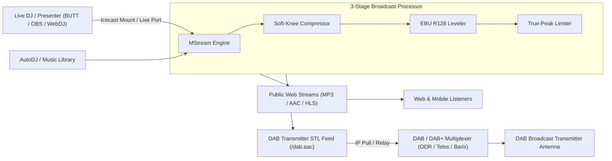
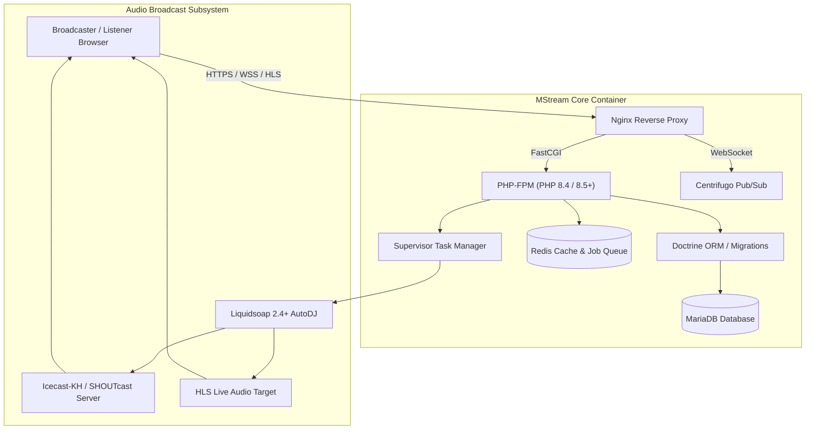

<div align="center">


# MStream
### Modern, High-Performance Web Radio & Audio Broadcast Management Suite

[](https://www.gnu.org/licenses/agpl-3.0)
[](https://www.php.net/)
[](https://vuejs.org/)
[](https://www.docker.com/)
[](https://www.liquidsoap.info/)

[Features](#-core-features) • [Installation](#-installation--quick-start) • [Architecture](#-architecture--stack) • [Broadcast STL & DAB](#-broadcast-stl--dab-transmitters) • [CLI Commands](#-cli-management) • [Security](#-hardened-security) • [License](#-license)

---

</div>

## 🌟 Overview

**MStream** is an enterprise-grade radio management and broadcast automation platform. Distributed as a turnkey containerized software suite, it packages an entire broadcasting stack—audio streamers, media auto-cues, multi-stage broadcast dynamics processing, live DJ managers, scheduling engines, and rich analytics—into an intuitive web interface and comprehensive RESTful API.

Whether managing a single community stream, coordinating a syndicated multi-mount network, or feeding IP audio directly to a **DAB / DAB+ broadcast transmission site (STL)**, MStream delivers broadcast-grade audio processing with unmatched operational stability.

---

## ⚡ Core Features

### 🎛️ 3-Stage Broadcast Dynamics Processor Chain
* **Soft-Knee Downward Compressor**: 4dB soft-knee compressor with 15ms/100ms timing that tames unruly transients and glues music and speech together with a warm, punchy broadcast feel.
* **EBU R128 / ITU-R BS.1770 Dynamic Loudness Leveler**: Continuous integrated loudness control (default `-16 LUFS`) ensuring older acoustic tracks, modern pop, station IDs, and live DJ feeds maintain consistent perceived volume without pumping.
* **True-Peak Lookahead Brickwall Limiter**: Automatic sub-clip lookahead limiter (`-1.5 dBTP`) that prevents inter-sample digital clipping on lossy MP3/AAC web streams and DAB broadcast links.

### 🎧 Intelligent AutoDJ & Media Engine
* **Next-Gen Liquidsoap Automation**: Powered by Liquidsoap 2.4+ with custom cross-length blend controls (MediaCP MCP-2510 parity), smart volume-aware dB fades, and cue point overrides.
* **Granular Playlists & Scheduling**: Fixed-time, weighted rotation, once-per-hour/x-songs, and priority interrupting schedules.
* **Scheduled Audio Channel Relays**: Automated chunked stream relays ensuring interrupting priority schedules and live DJs transition cleanly without delay.
* **Visual Waveform Cue Editor**: Integrated visual track editor with automatic EBU R128 loudness normalization and ReplayGain calculation.

### 🎙️ Live Broadcasting & Streamer Access
* **Individual Streamer Accounts**: Dedicated DJ/Presenter credentials with scheduled on-air time restrictions.
* **Seamless Live Handoff**: Liquidsoap-assisted live-aware crossfading with metadata preservation.
* **WebDJ & Remote Ingestion**: Ingest live audio via Icecast/SHOUTcast protocols (e.g. BUTT, Mixxx, OBS) or broadcast directly from browser inputs with the built-in multi-channel WebDJ mixer.

### 📻 Broadcast STL & DAB Transmitters
* **Dedicated Transmitter Mounts**: Stream low-latency, unlisted high-bitrate AAC-LC / HE-AAC feeds specifically for DAB/DAB+ multiplexer links (ODR-AudioEnc, Telos, Factum, 2wcom, Barix Exstreamer).
* **Remote Relays (Push/Pull)**: Push audio directly to remote transmitter sites or allow transmission equipment to pull audio securely over IP.
* **Simultaneous Broadcast**: Live DJs, AutoDJ, and web listeners are all fed simultaneously through the same unified broadcast chain.

### 📊 Real-Time Analytics & Listener Insights
* **Live Listener Tracking**: Interactive geographic listener mapping, user-agent breakdowns, and concurrent listener graphs.
* **Branded Player with Live Listener Counts**: Embedded and public player widgets featuring real-time listener counts, album art, and multi-stream selection.
* **Song History & Reporting**: Performance analytics, listener retention tracking, and exportable SoundExchange/royalty compliance reports.

### 🎙️ Podcasting Suite
* **Full Podcast Management**: Host multiple podcasts per station, complete with RSS 2.0 / iTunes / Google Podcasts feeds.
* **Episode Publishing & Scheduling**: Draft, schedule, and distribute podcast episodes with dedicated cover art and chapter markers.

### 🎨 Modern Aesthetic & User Experience
* **Modern Design System**: Sleek Obsidian (`#090d16`), Royal Indigo (`#6366f1`), Electric Cyan (`#06b6d4`), and Violet theme.
* **1-Click Theme Switcher**: Instant navbar toggle between Dark and Light modes.
* **Enhanced Player Controls**: Hardware MediaSession support (Bluetooth, lockscreen, smartwatch) and global keyboard shortcuts (`M` for instant mute).

### 🔔 Automation & Integrations
* **Rich Webhooks**: Push "Now Playing" updates, song metadata, and station alerts to **Discord**, **Bluesky**, **Mastodon**, **Telegram**, or generic JSON endpoints.
* **OpenAPI REST API**: Comprehensive, typed API covering all administrative and station operations.

---

## 🚀 Installation & Quick Start

### ⚡ 1-Line Turnkey Installer (Recommended)

Deploy MStream onto any fresh or existing Linux server with a single command. The turnkey installer handles **everything automatically**—detecting system architecture, installing Docker & Docker Compose if missing, automatically provisioning all necessary `.env` and `docker-compose.yml` configurations with hardened database secrets, and launching the full stack without needing to manually edit any files:

```bash
curl -fsSL https://raw.githubusercontent.com/merlinthedev848/MStream/main/install.sh | sudo bash
```

> [!TIP]
> **Interactive Setup Wizard**: The installer launches an interactive wizard asking a few simple questions (Release Channel, HTTP, HTTPS, and SFTP ports) or automatically uses recommended defaults if you press `[Enter]`.
>
> For completely unattended / headless deployments (e.g. CI/CD or Cloud-Init scripts), append `--unattended`:
> ```bash
> curl -fsSL https://raw.githubusercontent.com/merlinthedev848/MStream/main/install.sh | sudo bash -s -- --unattended
> ```

---

### 📦 Manual / Local Repository Setup

If you prefer to inspect the source code or install inside an existing directory:

```bash
# 1. Clone repository
git clone https://github.com/merlinthedev848/MStream.git /var/mstream
cd /var/mstream

# 2. Run the automated installer:
sudo bash install.sh

# Or launch directly with the MStream CLI helper (config files are auto-provisioned):
./mstream.sh up
```

### 3. Complete Setup in Browser
Once started, navigate to:
```
http://<your-server-ip> (or https://<your-domain>)
```
Follow the initial web wizard to create your Super Administrator account and begin broadcasting!

---

## 📻 Broadcast STL & DAB Transmitters

MStream is built to serve as a high-reliability **Studio-to-Transmitter Link (STL)** over IP for Digital Audio Broadcasting (DAB / DAB+) sites:



1. **Create a Private DAB Mount Point**:
   - In **Station Profile** $\rightarrow$ **Mount Points**, add a `/dab` mount in AAC+ or MP3.
   - Set the bitrate required by your multiplex (e.g. `128 kbps` or `192 kbps`).
   - Toggle **Visible in Public Pages** to **OFF** so bandwidth is reserved exclusively for the transmitter.
2. **Point your DAB Encoder to MStream**:
   - Configure your DAB audio encoder (ODR-AudioEnc, Telos, Barix, Factum) to ingest `http://<your-server>:8000/dab` or the HTTPS stream URL.
3. **Live DJ Auto-Handoff**:
   - Whenever a DJ connects live, their broadcast is seamlessly processed through the dynamics chain and sent to the DAB transmitter in real time without downtime.

---

## 🛠️ CLI Management

MStream includes a complete CLI management toolset. Execute commands within the web container:

```bash
# Run initial setup / migration
docker compose exec --user=mstream web mstream:setup
# Or using the MStream CLI helper:
./mstream.sh cli mstream:setup

# Check system status
docker compose exec --user=mstream web mstream:status

# Restart radio backend services for a station
docker compose exec --user=mstream web mstream:radio:restart <station_id_or_shortcode>

# Clear application caches & optimize
docker compose exec --user=mstream web mstream:cache:clear

# Backup station data and databases
docker compose exec --user=mstream web mstream:backup:run
```

---

## 🔒 Hardened Security

MStream is built with defense-in-depth security:
* **PHP Runtime Protection**: Protected against **CVE-2026-109618** and **CVE-2026-109619** ("PHP2Shell") via patched PHP 8.5/8.4 runtimes, zero-buffer `stream_copy_to_stream` upload assembly, and strict FPM worker cycling (`pm.max_requests`).
* **CGI Path Hardening**: Strict `cgi.fix_pathinfo=0` enforcement preventing script path confusion.
* **Granular RBAC**: Role-Based Access Control restricting station administration, playlist modification, and API token generation.
* **Encrypted Secrets**: Sensitive credentials (mount passwords, webhook secrets, SFTP keys) are stored with cryptographic hashing and salt boundaries.

---

## 🏗️ Architecture & Stack



* **Backend**: PHP 8.4/8.5, Slim 4 Framework, Doctrine ORM, Monolog, Flysystem.
* **Frontend**: Vue.js 3.5+, Pinia Store, Vite, Bootstrap 5.3+, Chart.js, HLS.js.
* **Audio Engine**: Liquidsoap 2.4+, Icecast 2.4-KH, FFmpeg, MasterMe audio mastering.
* **Realtime**: Centrifugo SSE/WebSocket engine for sub-second Now Playing broadcasts.

---

## 📄 License

MStream is open-source software licensed under the **[Affero GNU General Public License v3.0 (AGPL-3.0)](LICENSE.md)**.
